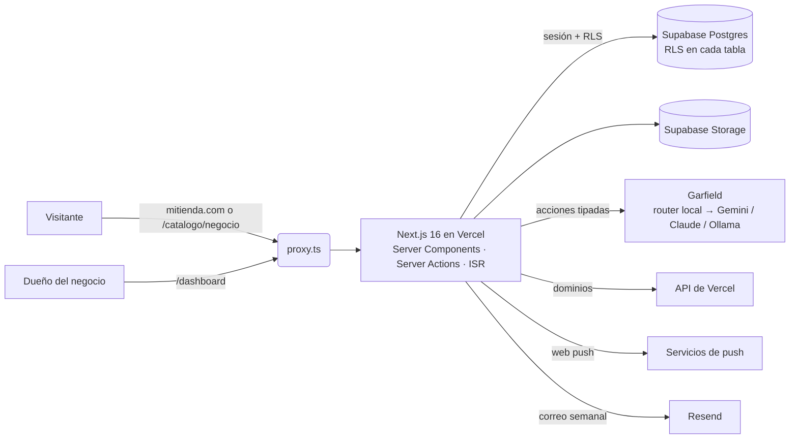

# Vitrina: sitio web, catálogo y PDF para pequeños negocios

[](https://github.com/JosueOmar320/catalogo-saas/actions/workflows/ci.yml)
[](https://github.com/JosueOmar320/catalogo-saas/actions/workflows/codeql.yml)


[English](README.md) · **Español**

SaaS multi-tenant para que un pequeño negocio (una cafetería, una ferretería, un estudio de servicios…) arme su sitio web **sin código**. El sitio funciona además como **catálogo de productos y servicios**, recibe pedidos por WhatsApp y se exporta a un **PDF listo para imprimir**. **Garfield**, un asistente con IA, edita el sitio a partir de pedidos en lenguaje natural.

**Demo en vivo:** [sitio de ejemplo](https://catalogo-saas-nu.vercel.app/demo) · [catálogo PDF](https://catalogo-saas-nu.vercel.app/demo/pdf) · [landing](https://catalogo-saas-nu.vercel.app)


<table>
  <tr>
    <td width="50%"></td>
    <td width="50%"></td>
  </tr>
</table>
<table>
  <tr>
    <td width="80%"></td>
    <td width="20%"></td>
  </tr>
</table>

## Qué hace

- **Editor visual del sitio:** páginas, 27 tipos de sección, 10 plantillas, temas con escalas de tipografía y espaciado, barras de navegación (también vertical) y pies de página. Vista previa en escritorio, tablet y celular, con deshacer, rehacer e historial de versiones.
- **Catálogo y pedidos:** buscador, filtros, atributos propios, opciones del producto, precios por mayoreo, productos de temporada y favoritos. El visitante arma su pedido, que se envía por WhatsApp y además llega a la bandeja del panel.
- **Catálogo PDF:** se genera con las mismas secciones y el mismo tema que la web, así que el sitio y el PDF nunca se desfasan.
- **Garfield AI:** asistente en el editor y en todo el panel. Lo simple se resuelve al instante sin IA. Lo creativo va a Gemini, Claude o un modelo local, que sólo puede *proponer* acciones tipadas y validadas.
- **Herramientas del negocio:**
  - bandeja de pedidos y clientes
  - avisos push al instante (el panel se instala como app)
  - estadísticas de ventas (visitas → productos vistos → agregados → pedidos, por origen)
  - reseñas con respuesta
  - etiquetas con QR, importar y exportar en CSV, precios programados
- **Plataforma:**
  - panel de administración con registro de auditoría
  - funciones encendidas o apagadas por negocio
  - dominio propio (`mitienda.com`, conectado por la API de Vercel)
  - HTML, CSS y widgets propios aislados
  - interfaz en español e inglés

Todas las funciones, área por área: [docs/FUNCIONALIDADES.md](docs/FUNCIONALIDADES.md).

## Decisiones técnicas destacadas

| Tema | Decisión | Por qué |
| --- | --- | --- |
| Aislamiento multi-tenant | RLS en las 26 tablas y en Storage, claves foráneas compuestas `(business_id, id)` y funciones `SECURITY DEFINER` con `search_path` vacío para lo privilegiado. | Un bug de la app, o una llamada directa a la API REST, no puede cruzar negocios. 417 pruebas de base de datos corren cada migración sobre Postgres real (PGlite) y lo verifican. |
| Rendimiento del sitio público | Una RPC por negocio (`get_public_catalog`), cacheada con ISR y una etiqueta por negocio. El rol anónimo no lee tablas. El bundle público no incluye Zod, y una prueba lo verifica. | Una visita no cacheada hace una sola llamada a la base, y publicar invalida sólo ese negocio. |
| Un modelo, dos destinos | Las mismas secciones y tokens de diseño se dibujan en React para la web y en `@react-pdf/renderer` para el PDF. | El PDF siempre coincide con el sitio, y hay un solo sistema de diseño que mantener. |
| Guardado seguro | El editor trabaja en memoria y guarda en una transacción con versión optimista (`site_version`). | No quedan estados a medias, y dos personas no se pisan sin enterarse. |
| IA acotada | El modelo devuelve acciones tipadas (Zod) que pasan por el mismo reducer y los mismos permisos que la interfaz. Funciona sin clave de API. | Un prompt malicioso no puede hacer nada que el usuario no pudiera hacer. |
| Código no confiable | El HTML propio se sanitiza en el servidor. Los scripts sólo corren en un iframe `srcdoc` aislado, sin `allow-same-origin`. El CSS queda limitado al sitio. | Todos los negocios comparten origen con el panel, así que sus scripts nunca deben correr en él. |
| Dominio propio | `proxy.ts` identifica el negocio por el host (consulta con caché) y reescribe a las mismas páginas cacheadas. El alta y la verificación usan la API de Vercel. | Un solo despliegue sirve el dominio de cada negocio. En los hosts de la plataforma el proxy sólo corre donde hay sesión, así que el catálogo público sigue siendo barato. |
| Entradas endurecidas | Descargas a prueba de SSRF (la IP se verifica al conectar), celdas CSV neutralizadas, login con límite de intentos y cabeceras de seguridad. | Son las superficies de ataque típicas de un SaaS, cada una cubierta por pruebas. |

Más detalle: [arquitectura](docs/ARQUITECTURA.md) · [guía de instalación, despliegue, pruebas y seguridad](docs/GUIA.md) · [idiomas](docs/I18N.md) · [Garfield AI](docs/GARFIELD-AI.md) · [roadmap](docs/ROADMAP.md) · [cambios](CHANGELOG.md).

## Arquitectura



## Calidad

| Capa | Pruebas | Qué cubren |
| --- | --- | --- |
| Base de datos | 417 | Cada migración en orden, RLS por tabla y rol, límites de plan, RPC de administración, auditoría, retención y dominio propio. Corre sobre PGlite, sin Docker. |
| Unitarias | 463 | Seguridad (SSRF, redirecciones, rutas de Storage), reducer del editor, router y ejecutores de Garfield, PDF, pedidos, estadísticas y dominios. La cobertura de líneas es del 94 %. |
| End-to-end | 58 | Sitio público, landing y pedido en escritorio y celular, con revisión automática de accesibilidad (axe, WCAG 2.1 AA). |
| End-to-end con sesión | 48 | Flujos completos contra un Supabase local en Docker: el administrador crea un negocio, el dueño publica, un visitante pide, bandeja, estadísticas y dominio propio. |

La CI corre en cada pull request: typecheck y lint, todas las pruebas anteriores, build de producción, `npm audit`, revisión de dependencias, gitleaks y CodeQL. Dependabot mantiene las dependencias al día. Ningún job necesita secretos.

## Stack

Next.js 16 (App Router, Server Actions, `proxy.ts`) · React 19 · TypeScript (estricto) · Supabase (Postgres, Auth, Storage) · Zod 4 · MUI 9 (sólo el panel) · `@react-pdf/renderer` · sharp · Web Push · Playwright · Vercel.

## Correrlo en local

Necesitas Node.js 24 (ver `.nvmrc`).

```bash
npm ci
```

```bash
npm run dev
```

La landing, `/demo` y `/demo/pdf` funcionan sin backend. El panel necesita Supabase; sigue la [guía](docs/GUIA.md#configurar-supabase).

```bash
npm run check
```

Eso corre typecheck, lint, pruebas unitarias y pruebas de base de datos, sin Docker ni Supabase.

## Licencia

© 2026 Josue Flores. **Todos los derechos reservados.** El código se publica sólo para revisión y como portafolio. No se puede copiar, modificar, distribuir ni usar comercialmente sin permiso por escrito. Ver [LICENSE](LICENSE).
