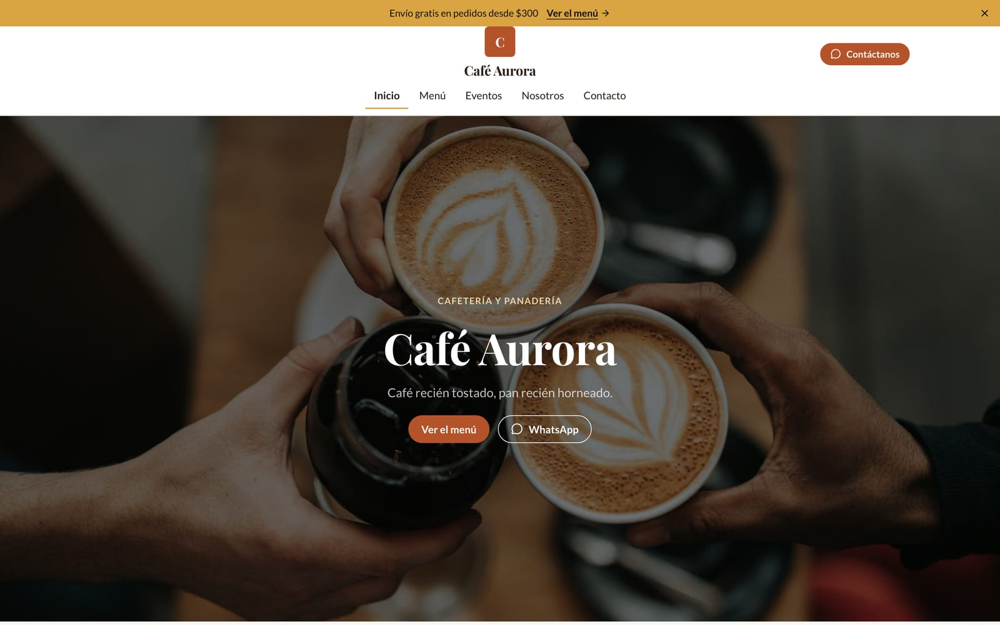
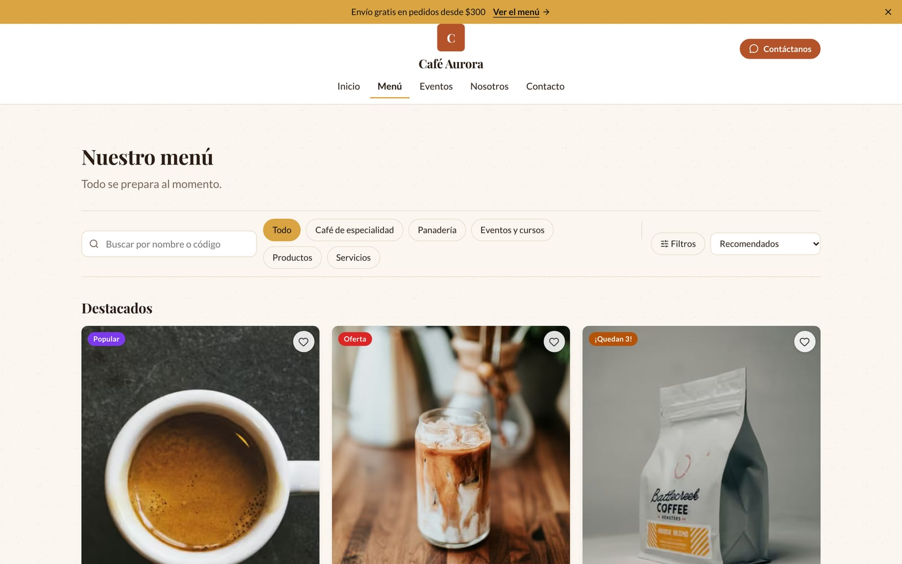
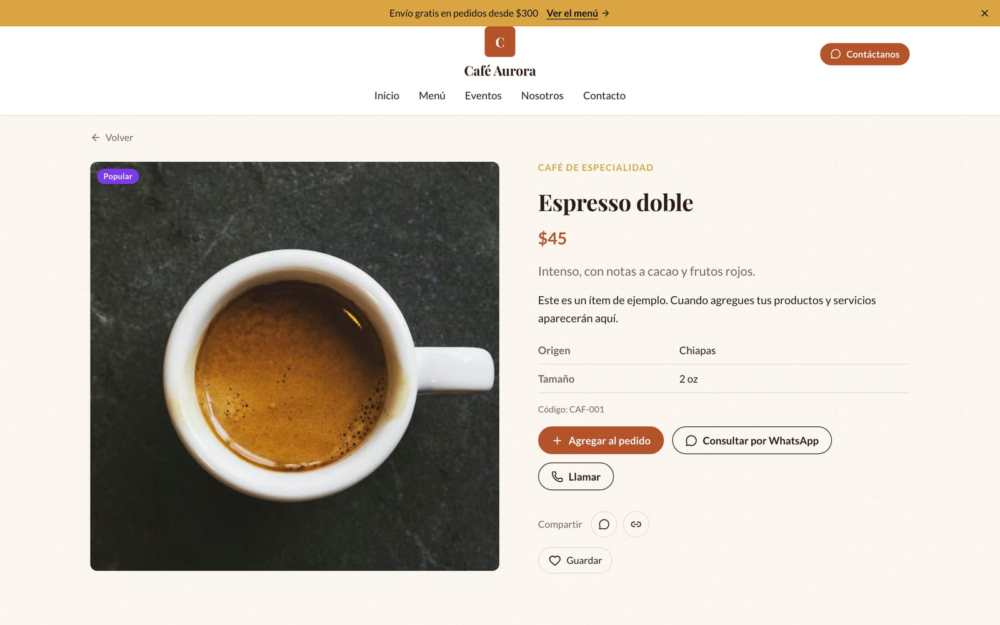
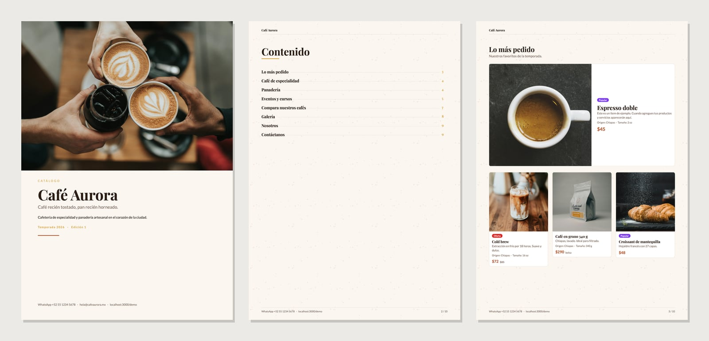
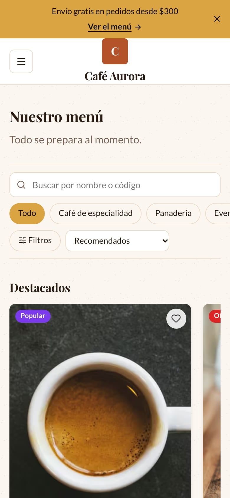
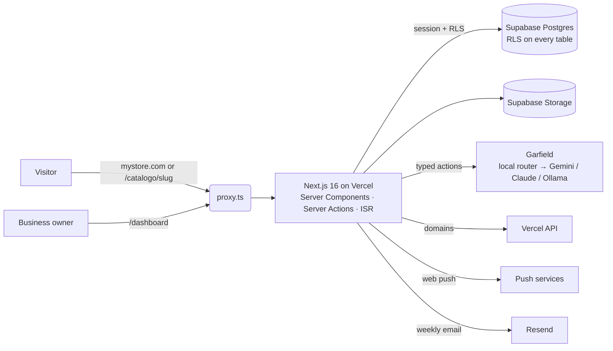

# Vitrina — website, catalog and PDF builder for small businesses

[](https://github.com/JosueOmar320/catalogo-saas/actions/workflows/ci.yml)
[](https://github.com/JosueOmar320/catalogo-saas/actions/workflows/codeql.yml)


**English** · [Español](README.es.md)

A multi-tenant SaaS where a small business (a café, a hardware store, a service studio…) builds its own website **without code**. The site doubles as a **product and service catalog** that takes orders over WhatsApp, and exports to a **print-ready PDF**. **Garfield**, an AI assistant, edits the site from plain-language requests.

**Live demo:** [sample site](https://catalogo-saas-nu.vercel.app/demo) · [PDF catalog](https://catalogo-saas-nu.vercel.app/demo/pdf) · [landing page](https://catalogo-saas-nu.vercel.app)



<table>
  <tr>
    <td width="50%"></td>
    <td width="50%"></td>
  </tr>
</table>
<table>
  <tr>
    <td width="80%"></td>
    <td width="20%"></td>
  </tr>
</table>

## What it does

- **Visual site builder:** pages, 27 section types, 10 site templates, themes with typography and spacing scales, navbars (including a vertical one) and footers. Live preview on desktop, tablet and phone, plus undo/redo and version history.
- **Catalog and orders:** search, filters, custom attributes, product options, wholesale pricing, seasonal products and favorites. Visitors build an order that is sent over WhatsApp and also lands in the dashboard's order inbox.
- **PDF catalog:** generated from the same sections and theme as the website, so the two never drift apart.
- **Garfield AI:** a chat assistant in the editor and across the dashboard. Simple requests are resolved instantly without an LLM. Creative ones go to Gemini, Claude or a local model, which can only *propose* typed, validated actions.
- **Business tools:**
  - customers list and order inbox
  - instant push notifications (installable PWA)
  - sales funnel analytics (visits → product views → cart → order, by traffic source)
  - reviews with replies
  - QR labels, CSV import and export, scheduled prices
- **Platform:**
  - an admin console with an audit log
  - per-business feature toggles
  - custom domains (`mystore.com`, provisioned through the Vercel API)
  - sandboxed custom HTML, CSS and widgets
  - Spanish and English UI

Every feature, area by area: [docs/FUNCIONALIDADES.md](docs/FUNCIONALIDADES.md) (Spanish).

## Engineering highlights

| Topic | Decision | Why |
| --- | --- | --- |
| Multi-tenant isolation | Row Level Security on all 26 tables and on Storage, composite foreign keys `(business_id, id)`, and `SECURITY DEFINER` functions with an empty `search_path` for privileged operations. | A bug in the app, or a direct call to the REST API, cannot cross tenants. 417 database tests run every migration on real Postgres (PGlite) and check it. |
| Public site performance | One RPC per business (`get_public_catalog`), cached with ISR and a per-business tag. The anonymous role cannot read tables. The public bundle stays free of Zod (enforced by a test). | An uncached visit costs a single database call, and publishing invalidates only that business. |
| One model, two renderers | The same sections and design tokens render to React on the web and to `@react-pdf/renderer`. | The PDF always matches the site, and there is a single design system to maintain. |
| Safe saves | The editor works in memory and saves in one transaction with optimistic versioning (`site_version`). | No half-saved states, and two people can't silently overwrite each other. |
| Constrained AI | The model returns typed actions (Zod) that go through the same reducer and permissions as the UI. It works without an API key. | A malicious prompt can't do anything the user couldn't already do. |
| Untrusted code | Custom HTML is sanitized on the server. Scripts run only inside a sandboxed `srcdoc` iframe without `allow-same-origin`. Custom CSS is scoped to the site. | Every tenant shares one origin with the dashboard, so tenant scripts must never run on it. |
| Custom domains | `proxy.ts` resolves the host to a business (cached lookup) and rewrites to the same cached pages. Domains are added and verified through the Vercel API. | One deployment serves every tenant's domain. The proxy runs on platform hosts only where a session is needed, so the public catalog stays cheap. |
| Hardened inputs | SSRF-safe downloads (the IP is checked at connect time), CSV formula neutralization, rate-limited login, strict security headers. | These are the usual SaaS attack surfaces, each covered by tests. |

More detail, in Spanish: [architecture](docs/ARQUITECTURA.md) · [setup, deployment, testing and security guide](docs/GUIA.md) · [i18n](docs/I18N.md) · [Garfield AI](docs/GARFIELD-AI.md).

## Architecture



## Quality

| Layer | Tests | What they cover |
| --- | --- | --- |
| Database | 417 | Every migration in order, RLS per table and role, plan limits, admin RPCs, audit log, retention, custom domains. Runs on PGlite, no Docker needed. |
| Unit | 463 | Security (SSRF, redirects, storage paths), editor reducer, Garfield router and executors, PDF, orders, analytics, domains. Line coverage is 94%. |
| End-to-end | 58 | Public site, landing and ordering on desktop and mobile, with automated accessibility checks (axe, WCAG 2.1 AA). |
| End-to-end, signed in | 48 | Full flows against a local Supabase in Docker: admin creates a business, owner publishes, a visitor orders, inbox, analytics, custom domain. |

CI runs on every pull request: typecheck and lint, all of the tests above, a production build, `npm audit`, dependency review, gitleaks and CodeQL. Dependabot keeps dependencies current. No job needs secrets.

## Tech stack

Next.js 16 (App Router, Server Actions, `proxy.ts`) · React 19 · TypeScript (strict) · Supabase (Postgres, Auth, Storage) · Zod 4 · MUI 9 (dashboard only) · `@react-pdf/renderer` · sharp · Web Push · Playwright · Vercel.

## Run it locally

Requires Node.js 24 (see `.nvmrc`).

```bash
npm ci
```

```bash
npm run dev
```

The landing page, `/demo` and `/demo/pdf` work without any backend. The dashboard needs Supabase; follow the [setup guide](docs/GUIA.md#configurar-supabase).

```bash
npm run check
```

That runs typecheck, lint, unit tests and database tests, with no Docker or Supabase required.

## License

© 2026 Josue Flores. **All rights reserved.** The source is published for review and portfolio purposes only. It may not be copied, modified, distributed or used commercially without written permission. See [LICENSE](LICENSE).
